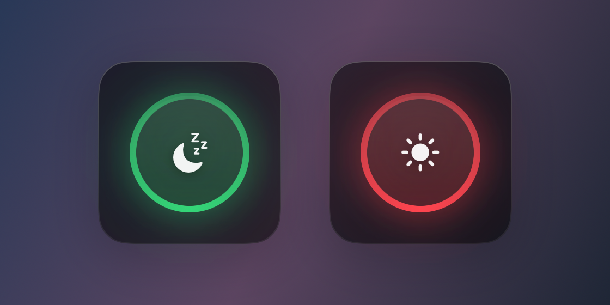

<h1 align="center">Clamshell</h1>

<p align="center">
  A one-switch macOS desktop widget for <code>pmset disablesleep</code>.
</p>

<p align="center">
  
</p>

<p align="center">
  <strong>Green</strong> — the Mac sleeps normally. &nbsp;·&nbsp; <strong>Red</strong> — sleep is blocked, so it keeps running with the lid closed.
</p>

---

Keeping a Mac awake with the lid shut means remembering `sudo pmset -a disablesleep 1`,
and there is no good way to see whether it is on: when the setting is off, `pmset -g`
does not print it at all. Clamshell is a frosted-glass widget that sits on the desktop,
shows the real state at a glance and flips it with one click.

## Install

Requires macOS 13 or later. Builds a universal binary for Apple Silicon and Intel.

```sh
git clone https://github.com/matabar/clamshell.git
cd clamshell
make install          # builds Clamshell.app, copies it to /Applications, launches it
```

Or `make run` to build and launch it straight from `./build` without installing.

Prebuilt `.zip` downloads from [Releases](https://github.com/matabar/clamshell/releases)
are ad-hoc signed rather than notarized, so the first launch needs a right-click → **Open**,
or:

```sh
xattr -dr com.apple.quarantine /Applications/Clamshell.app
```

## Using it

The widget has no chrome and the app has no Dock icon — everything lives in the ring
and the menu bar glyph.

| | |
|---|---|
| **Click the ring** | Toggle lid sleep. macOS asks you to authenticate. |
| **Drag the panel edge** | Move the widget. Its position is remembered. |
| **Right-click the widget**, or click the menu bar glyph | Open the menu. |
| **Click the menu bar glyph** | Toggle without opening the menu. |

The menu bar glyph mirrors the ring, so the state stays readable while the widget is
sitting behind your windows.

### Window layer

By default the widget sits on the **desktop** layer: above the wallpaper, behind every
application window, visible on all Spaces — a real widget rather than a floating panel.
Switch it to **Floating** from *Window Layer* in the menu when you want it on top of
everything instead.

### Staying in sync

Clamshell never trusts its own last write. It reads `SleepDisabled` from `IOPMrootDomain`
every two seconds, plus on wake and on activation, so changing the setting from a terminal
or another tool is reflected in the ring within about two seconds.

## Toggling without a password

`pmset -a disablesleep` needs root, so by default every toggle brings up the standard macOS
administrator dialog. (AppleScript caches the credential for about five minutes, so a quick
flip back does not prompt again.)

If you toggle often, **Toggle Without Password…** in the menu installs this one rule at
`/etc/sudoers.d/clamshell`:

```
<your-user> ALL=(root) NOPASSWD: /usr/bin/pmset -a disablesleep 0, /usr/bin/pmset -a disablesleep 1
```

Worth knowing before you enable it:

- It grants exactly those two command lines to your user, nothing else — sudoers matches the
  full argument list, so `pmset` cannot be used for anything other than flipping this flag.
- `/usr/bin/pmset` is owned by root and protected by System Integrity Protection, so the
  binary behind the rule cannot be swapped out.
- The file is staged in a temporary location and validated with `visudo -c` before it is
  installed, so a malformed rule can never lock you out of `sudo`.
- **Require Password to Toggle…** in the same menu removes it again.

Declarative setups (nix-darwin, MDM) may prefer to manage the rule themselves — Clamshell
detects any existing permission with `sudo -n -l` and skips the dialog when one is present.

## What the setting actually does

`disablesleep 1` stops macOS from sleeping at all — idle sleep and lid-close sleep alike.
That is what makes clamshell mode work, and it also means:

- A closed Mac in a bag keeps running and keeps getting warm. Flip it back to green when
  you are done.
- Display sleep is untouched; the screen still turns off on its own.
- The setting survives reboots, which is exactly why having the state visible helps.

## How it works

| | |
|---|---|
| **Reading state** | `IORegistryEntryCreateCFProperty` on `IOPMrootDomain` for `SleepDisabled`. No subprocess, no root, cheap enough to poll. Falls back to parsing `pmset -g custom` — where a missing `disablesleep` line means sleep is allowed. |
| **Writing state** | `sudo -n /usr/bin/pmset …` when the sudoers rule is present, otherwise AppleScript `do shell script … with administrator privileges`, run off the main thread so the UI keeps animating while the dialog is up. |
| **The window** | A borderless `NSWindow` over an `NSVisualEffectView` (`.hudWindow`, `.behindWindow`) pinned one level above `kCGDesktopWindowLevel`, with SwiftUI inside. |

Nothing user-supplied is ever interpolated into a shell or AppleScript string: the privileged
command is a fixed argument vector, and the sudoers installer travels base64-encoded inside
the AppleScript so there is no intermediate script file on disk to tamper with.

## Layout

```
Sources/Clamshell/
  PowerManagement.swift   reads SleepDisabled (IOKit, pmset fallback)
  Privileges.swift        sudo -n / admin dialog / sudoers rule install
  SleepController.swift   state machine, polling, error handling
  WidgetWindow.swift      borderless frosted window, desktop/floating level
  ToggleWidget.swift      the ring
  MenuBarController.swift status item and shared menu
Scripts/
  make-icon.swift         draws Clamshell.icns
  make-screenshots.swift  renders the README images from the real views
```

## Make targets

```
make bundle       build a universal Clamshell.app into ./build
make run          build and launch it
make install      copy it to /Applications and launch it
make uninstall    quit and remove it
make zip          package the bundle for distribution
make screenshots  regenerate the README images
make clean        remove build products
```

## Uninstall

```sh
make uninstall                        # or just delete /Applications/Clamshell.app
sudo rm -f /etc/sudoers.d/clamshell   # only if you enabled passwordless toggling
defaults delete com.matabar.clamshell # widget position and preferences
```

## License

MIT — see [LICENSE](LICENSE).
